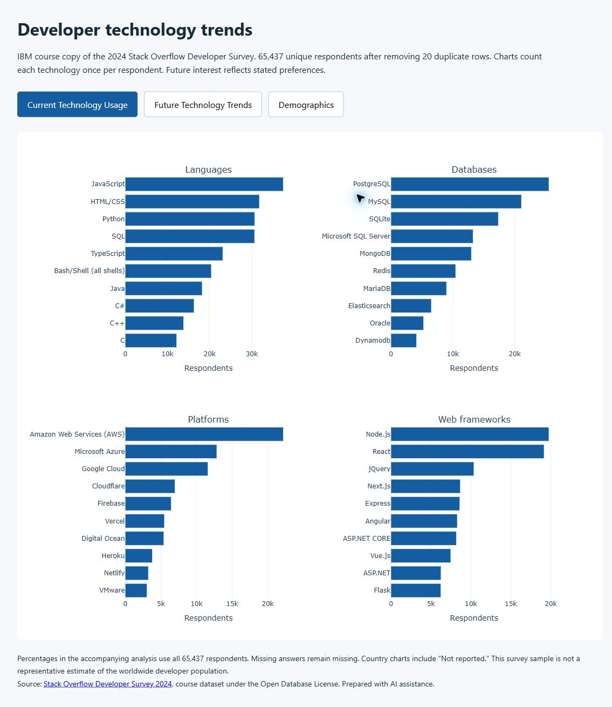

# IBM Data Analyst Capstone: developer technology trends

A reproducible portfolio analysis of the IBM course datasets, prepared for Dakshesh Gautam with AI assistance. The project compares technology use with future interest in the 2024 Stack Overflow survey and documents the separate job-listings and web-scraping exercises.

## Contents

- `notebooks/Developer_Technology_Trends.ipynb`: executed analysis with data cleaning and chart outputs.
- `src/analysis.py`: the same analysis as a runnable Python script.
- `src/jobs_api.py`: a local REST API used to collect job counts.
- `src/download_data.py`: downloads the official public course files.
- `data/derived/`: aggregated rankings, missing-value counts and demographic distributions.
- `reports/findings.md`: findings with methodological limitations.
- `reports/figures/`: exported figures.
- `reports/Data Analyst Capstone Project Report.pdf`: 20-page report using the course presentation template.
- `reports/Data Analyst Capstone Project Report.pptx`: editable presentation, including six native charts with embedded data workbooks.
- `reports/dashboard/`: screenshots of the three dashboard views.
- `data/derived/job-postings.xlsx`: job counts with both course matching and bounded matching.
- `dashboard.html`: a self-contained interactive portfolio dashboard with current-use, future-interest and demographic views.

The dashboard runs locally and is separate from a Cognos or Looker course submission. This repository does not contain quiz answers or certify completion of the Coursera course.



## Run the project

Use Python 3.11 or later:

```sh
python -m venv .venv
# Windows: .venv\Scripts\activate
# macOS/Linux: source .venv/bin/activate
python -m pip install -r requirements.txt
python src/download_data.py
python src/analysis.py
```

Open `dashboard.html` in a browser after analysis completes. To run the notebook, launch `jupyter lab` from the repository. Set `CAPSTONE_DATA_DIR` if the source files are already cached in another directory.

## Method

Exact duplicate survey rows are removed, then respondent IDs are checked for conflicts. Semicolon-separated technology choices are counted once per respondent. Percentages use all cleaned respondents, with missing-answer counts reported separately. Desired use reflects survey preferences and is not a forecast.

Job counts are collected through a localhost API. The supplied lab's case-sensitive substring method is preserved alongside a comparison that handles case and term boundaries. Neither version describes live city job markets. The salary table is an undated teaching example and remains separate from the survey's compensation field.

Raw respondent data is not committed. The dataset is roughly 155 MB, and its public download URL is retained for reproducibility.

## Sources and licensing

- [IBM course survey CSV](https://cf-courses-data.s3.us.cloud-object-storage.appdomain.cloud/VYPrOu0Vs3I0hKLLjiPGrA/survey-data-with-duplicate.csv), derived from the [Stack Overflow Developer Survey 2024](https://survey.stackoverflow.co/2024/). The course identifies this data as licensed under the [Open Database License](https://opendatacommons.org/licenses/odbl/1-0/). Derived survey CSV files retain this attribution and license.
- [IBM modified job-listings JSON](https://cf-courses-data.s3.us.cloud-object-storage.appdomain.cloud/IBM-DA0321EN-SkillsNetwork/labs/module%201/Accessing%20Data%20Using%20APIs/jobs.json). The lab attributes its source to [Jobs on Naukri.com](https://www.kaggle.com/promptcloud/jobs-on-naukricom) under a public-domain license. The modified course locations must not be interpreted as real current US hiring totals.
- [IBM language-salary HTML exercise](https://cf-courses-data.s3.us.cloud-object-storage.appdomain.cloud/IBM-DA0321EN-SkillsNetwork/labs/datasets/Programming_Languages.html). It supplies no survey date, geography, sample size or methodological details. The extracted CSV retains source attribution.
- [IBM Skills Network presentation template](https://cf-courses-data.s3.us.cloud-object-storage.appdomain.cloud/mxdlzMmLhySTVUJ1ePVVLw/Data%20Analyst%20Capstone%20Template%202026.pptx). The report preserves its layout, branding and supplied artwork. Those assets retain their original ownership.

The original IBM instructional notebooks are not redistributed here. New project code is provided under the MIT License. Data licenses and third-party library licenses remain separate.
